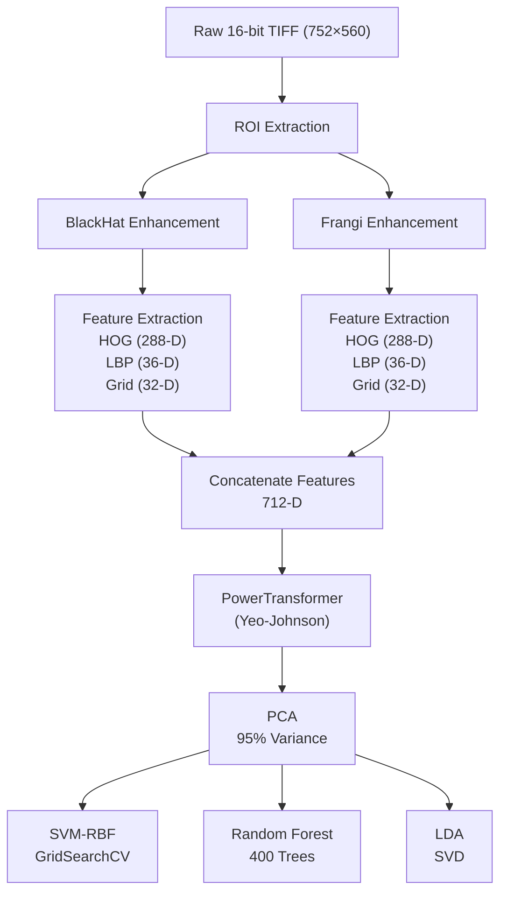

# Biometric classification of DHV - models - Training, Testing and Results

This Repository is a collaborative work of three members about the comphrehensive comparative model analysis & ablation study of the dorsal hand vein dataset : https://github.com/wilchesf/dorsalhandveins
### Github member IDs : 
1) Masked-peculiarity
2) thenameisyashwanth-sudo
3) Sirthebeast

This README is a high level architectural / pipeline summary of this repository 
All the technical implementations and explanations will be uploaded further.
# Dataset Clarification

The dataset contains two databases DB-1 & DB-2 
 - Database 1 -- 138 people, 4 images for each hand for a total of 1104 pictures
 - Database 2 -- 113 people, 3 images for each hand for a total of 678 pictures --- taken by a NIR camera
 - The persons labeled from 114 to 138 were not available for the recapture of vein images for DB-2
 - The time gap between the images from DB-1 and DB-2 is 2 months
 - The naming convention for the left hand images in both the DBs follows : person_xxx_dbx_Lx.tif / png
 - The naming convention for the right hand images in both the DBs follows : person_xxx_dbx_Rx.tif / png
 - All the images in the both the DBs follow 752×560 pixels, 16-bit quantization, TIFF format and PNG format

Since the Databse has a 2 month gap, We decided to use the entire DB-1 images for training and DB-2 images for testing 
This leaves with the problem of unavailability of images for testing from persons 114 to 138 in DB-2, Hence the persons (114 - 138) were dropped 
during testing, So a total of 904 images was used for training and 678 images was used for testing.
This decision was made to improve the robustness of the models which we were to train.

The above is the convention for all the experiments that were done.
Further data splitting strategies were made in the experiments.

# Region of Interest Extraction and Image Enhacement 

The following pipeline applied to the dorsal hand vein dataset prior to classification. <br>
The pipeline converts raw NIR hand images into standardised 128×128 grayscale patches containing only the central palm vein region, free of 
background, finger edges, and wrist artifacts.


Further image processing algorithms were used to capture the morphological and structure of the images of Region of Interest (ROI)

1. **Black Hat Transform** was used to highlight small, dark regions or details that are darker than their immediate surroundings and smaller than the chosen structuring element, This is mainly used for Feature collection and Background correction.

2. **Frangi Vesselness Filter** was used to act as a shape detector that selectively enhances thin, elongated, and tubular structures while suppressing background noise or spherical objects (like dust). The primary use case of this was Vessel Extraction.

Separate images for both the image processing algorithms was processed and stored in the Database for training the models not only on ROI, but to act as a comparision..

***
Dependencies that was used <br>
- opencv-python    >= 4.5  
- numpy            >= 1.21  
- scikit-image     >= 0.19  
***

Full technical summary is to be uploaded...


The below is the high level explanation of the experiments ( based on the literature survey which was done prior ) performed and their results...


# Experiment - 01
# Classical Machine Learning pipeline (SVM-rbf, Random Forest, LDA) with Handcrafted Feature Extraction

Classical machine learning algorithms can achieve strong performance on small and medium-sized biometric datasets when paired with carefully designed feature extraction techniques.
<br>
A major objective of this work was to understand which vein characteristics contribute to recognition performance.
The handcrafted feature pipeline provides interpretable descriptors:

- HOG captures vein orientation and edge structure.
- LBP captures local vein texture patterns.
- Grid Statistics capture spatial intensity distributions.
Unlike deep neural networks, where learned representations are often difficult to interpret, these features have clear physical meaning and can be directly related to vein morphology.

## System Architecture


## Methodology
## Feature Extraction
Instead of deep feature learning, discriminative handcrafted vein descriptors were extracted and fused into a single feature representation.

**HOG Features (Histogram of Oriented Gradients)**

HOG captures:
-  Vein edge orientations
- Local structural information
- Directional vein flow patterns

These descriptors encode the geometric arrangement of vein structures.

**LBP Features (Local Binary Patterns)**

LBP captures:
- Local texture information
- Micro-pattern variations
- Fine vessel textures

Uniform LBP encoding was used to improve robustness.

**Grid-Based Statistical Features**

The ROI is divided into a 4×4 grid.

For each cell: Mean intensity & Standard deviation are computed.

These features capture global vein distribution characteristics across the hand.

**Feature Fusion**

The final biometric representation is obtained by concatenating:  HOG Features + LBP Histogram + Grid Statistics
This creates a comprehensive feature vector containing:

- Structural information
- Texture information
- Spatial distribution information
- Dimensionality Reduction

Feature vectors are standardized using: StandardScaler

Followed by:

Principal Component Analysis (PCA)
PCA Configuration
Reduced to 30 principal components
Trained exclusively on DB1
Applied to DB2 without refitting

This prevents data leakage and preserves experimental integrity.

## Classification Models

Three classifiers were evaluated.

1) **Support Vector Machine (RBF Kernel)**

Characteristics:

-Non-linear decision boundaries
-Strong generalization capability
-Effective in high-dimensional spaces

2) **Random Forest**

Characteristics:

- Ensemble-based learning
- Robust to feature noise
- Captures complex decision boundaries

3) **Linear Discriminant Analysis (LDA)**

Characteristics:

- Maximizes class separability
- Computationally efficient
- Well suited for biometric identification tasks
- Identification Evaluation

## Results
Identification was performed as a 226-class classification problem.

Metrics
Rank-1 Accuracy, Rank-5 Accuracy, Confusion Matrix Analysis, Precision, Recall, F1 Score

### **Identification Results**

| Model           | Rank-1 Accuracy | Rank-5 Accuracy |
|----------------|-----------------|-----------------|
| SVM (RBF)      | 80.09%          | 84.96%          |
| Random Forest  | 65.04%          | 83.19%          |
| LDA            | 80.38%          | 88.79%          |

### **Observation**

LDA achieved the highest identification performance, obtaining:

80.38% Rank-1 Accuracy
88.79% Rank-5 Accuracy

despite the challenging two-month acquisition gap.

**Verification Evaluation**

Verification was performed using balanced genuine/impostor comparisons.

For each selected identity:

Genuine samples were collected.
Equal numbers of impostor samples were randomly selected.
Binary classifiers were trained and evaluated independently.
Metrics-  Equal Error Rate (EER), Area Under ROC Curve (AUC)

### **Verification Results**

| Model          | EER ↓  | AUC ↑  |
|---------------|--------|--------|
| SVM (RBF)     | 15.56% | 0.8593 |
| Random Forest | 17.78% | 0.8111 |
| LDA           | 35.56% | 0.6889 |

### **Observation**

**SVM** demonstrated the strongest verification capability with: **15.56%- Equal Error Rate, 0.8593 - AUC**
indicating superior genuine/impostor discrimination.

### Advanced Performance Analysis

**For the best identification model (LDA):

Metric	Value
Macro Precision - 	77.07%
Macro Recall	- 80.38%
Macro F1 Score	- 77.06%**

Confusion analysis revealed that most errors occurred between identities exhibiting highly similar dorsal vein structures or left/right hand symmetry.

### Key Contributions
- Automated anatomical ROI extraction using the largest inscribed circle and square strategy.
- Robust vein enhancement using Blackhat and Frangi filtering.
- Hybrid handcrafted feature representation combining HOG, LBP, and statistical descriptors.
- Leakage-free PCA and chronological train-test separation.
- Comprehensive evaluation under a realistic two-month temporal gap.
- Simultaneous assessment of both identification and verification performance.


# Experiment - 02
# Deep learning architecture - CNN and Pretrained Model (ResNet-18)

Unlike the classical machine learning pipeline, which relies on handcrafted feature extraction, this experiment employs deep neural networks to automatically learn discriminative vein representations directly from ROI images.

Two complementary architectures are investigated:

- Custom Convolutional Neural Network (VeinCNN)
- Transfer Learning with ResNet-18

## System Architecture


## Deep Learning Models

### Custom VeinCNN

A lightweight convolutional neural network was developed specifically for dorsal hand vein recognition.

The network progressively learns:

- Edge information
- Local vein textures
- Vascular structures
- Identity-specific biometric features

The architecture provides a computationally efficient solution while learning discriminative feature representations directly from the input images.

### ResNet-18

A transfer learning approach based on ResNet-18 was implemented to leverage deep residual feature learning.

The pretrained architecture was modified for dorsal hand vein recognition by:

- Adapting the first convolutional layer for grayscale input
- Replacing the final fully connected layer with a 226-class classifier
- Fine-tuning the network on dorsal hand vein images

Residual learning enables deeper feature extraction while reducing optimization difficulties associated with deeper networks.

<br>

## Deep Feature Learning

Unlike handcrafted descriptors such as HOG or LBP, the neural networks automatically learn hierarchical biometric representations during training.
The learned feature embeddings encode:

- Vein geometry
- Vessel connectivity
- Local vascular texture
- Global vein distribution
- Identity-specific anatomical characteristics
These learned representations replace manual feature engineering and are optimized directly through supervised learning.

## Training Strategy

Both networks were trained using supervised learning on DB1. The training pipeline includes:

- Cross-Entropy Loss
- Adam Optimizer
- Mini-batch training
- Validation monitoring
- Model checkpointing

The trained models are evaluated exclusively on DB2, ensuring that no information from the testing session influences training.

## Identification Evaluation

Identification is formulated as a 226-class closed-set classification problem. Each probe image is assigned to one of the enrolled left/right hand identities.

Evaluation Metrics : Rank-1 Accuracy, Rank-5 Accuracy, Precision, Recall, F1 Score, Confusion Matrix

## Identification Performance

| Model          | Rank-1 Accuracy | Rank-5 Accuracy |
|----------------|----------------:|----------------:|
| Custom VeinCNN | 51.18%          | 71.83%          |
| ResNet-18      | 73.16%          | 87.02%          |

### Observation

The ResNet-18 model substantially outperformed the custom CNN, achieving a 73.16% Rank-1 accuracy and 87.02% Rank-5 accuracy. The deeper residual architecture demonstrated a stronger ability to learn discriminative vein representations across the 226 biometric classes despite the temporal separation between enrollment and testing sessions.


## Verification Performance

Deep feature embeddings extracted from the trained models were further evaluated for biometric verification.

| Model          | Equal Error Rate (EER ↓) | AUC (↑) |
|----------------|-------------------------:|--------:|
| Custom VeinCNN | **9.99%**                | **0.9650** |
| ResNet-18      | **5.45%**                | **0.9878** |

### Observation

ResNet-18 also achieved the strongest verification performance, reducing the Equal Error Rate to 5.45% while obtaining an AUC of 0.9878, indicating highly discriminative feature embeddings for genuine and impostor pair separation.

<br>
<br>

This experiment investigates deep learning as an alternative to handcrafted feature engineering by enabling the model to learn biometric representations directly from image data.

The approach was selected because it offers:

- Automatic extraction of hierarchical vein representations
- Reduced dependence on manually designed descriptors
- Better scalability to larger biometric datasets
- Improved capability to model complex vascular patterns

By comparing a lightweight custom CNN with a deeper transfer learning architecture, the project explores the trade-off between computational efficiency and recognition performance.

## Key Contributions
- Adaptation of ResNet-18 for grayscale NIR dorsal hand vein images.
- 226-class biometric identification framework treating left and right hands as independent identities.
- Deep feature learning without handcrafted feature engineering.
- Comprehensive assessment using both identification and verification metrics.


# Experiment - 03
# Classical Machine Learning pipeline (SVM-rbf, Random Forest, LDA) with Fused Handcrafted Features and comparison between 113 classes and 226 classes

Two identity schemes are evaluated in parallel: a 226-class scheme treating each hand (left and right) as a separate identity, and a 113-class scheme merging both hands per person. All 113 overlapping subjects between the two databases are used.

## System Architecture



## Feature Extraction

| Component | Details | Dimensionality |
|-----------|---------|---------------:|
| Enhancement 1 | BlackHat morphology + CLAHE | — |
| Enhancement 2 | Frangi vesselness + CLAHE | — |
| HOG | 8 orientations, 16×16 px cells, 2×2 blocks, L2-Hys norm | 288-D × 2 |
| LBP (fine) | P=8, R=1, uniform | 10-D × 2 |
| LBP (coarse) | P=24, R=3, uniform | 26-D × 2 |
| Grid density | 4×4 grid, mean + std per cell | 32-D × 2 |
| **Fused total** | BlackHat channel + Frangi channel concatenated | **712-D** |

## Preprocessin & Models

| Stage | Method | Notes |
|-------|--------|-------|
| Normalisation | PowerTransformer (Yeo-Johnson) | Handles skewed HOG/LBP distributions better than StandardScaler |
| Dimensionality reduction | PCA (95% variance retained) | Adapts to intrinsic dimensionality of each class scheme |
| SVM-RBF | GridSearchCV: C ∈ {1, 10, 100}, γ ∈ {scale, auto, 0.01}, 3-fold CV on train only | `class_weight='balanced'` |
| Random Forest | 400 trees, `max_features='sqrt'`, `min_samples_leaf=2` | `class_weight='balanced'` |
| LDA | `solver='svd'` | Numerically stable post-PCA; verify scores require calibration (see Notes) |

## Results

### Identification (Rank-1 / Rank-5 Accuracy)

| Scheme | Model | Rank-1 (%) | Rank-5 (%) |
|--------|-------|-----------:|-----------:|
| 226-class | SVM-RBF (tuned) | 80.53 | 79.65 |
| 226-class | Random Forest | 55.60 | 76.25 |
| 226-class | LDA | 80.97 | 87.61 |
| 113-class | SVM-RBF (tuned) | 80.53 | 82.60 |
| 113-class | Random Forest | 61.36 | 79.06 |
| 113-class | LDA | 73.30 | 84.22 |

### Verification (EER / AUC, averaged over 15 probe identities)

| Scheme | Model | Avg EER (%) ↓ | Avg AUC ↑ |
|--------|-------|--------------:|----------:|
| 226-class | SVM-RBF (tuned) | 8.89 | 0.9185 |
| 226-class | Random Forest | 13.33 | 0.8741 |
| 226-class | LDA | 53.33 | 0.4370 |
| 113-class | SVM-RBF (tuned) | 11.11 | 0.9093 |
| 113-class | Random Forest | 16.67 | 0.8889 |
| 113-class | LDA | 54.44 | 0.4278 |


## Key Contributions

- **SVM-RBF** is the **strongest classical baseline**, achieving **~80.5% Rank-1 accuracy** and **AUC ≈ 0.92** under strict cross-session conditions. The tuned hyperparameters (**C = 10**, **γ = scale**) indicate that the default settings were already **near-optimal** for this feature space.

- **Random Forest** shows a **large Rank-1 / Rank-5 gap** (**~20 percentage points** in the 226-class case). It often places the correct identity in the **top-5** but struggles to rank it first, suggesting sensitivity to **session-specific texture changes** across the **2-month gap**.

- **LDA** performs well for **identification** but **poorly for verification**. Although it achieves **81% Rank-1 accuracy** (226-class), its **53% EER** and **0.44 AUC** indicate poorly calibrated probability scores. Using **`CalibratedClassifierCV`** would improve its suitability for verification.

- The difference between the **113-class** and **226-class** schemes is **small**. **Random Forest** benefits the most (**+5.8 percentage points Rank-1**) from merging left and right hands, while **SVM-RBF** remains largely unchanged and **LDA** degrades slightly.


# The above architecture & experiments is made as an ablation study, this is made as the baseline for the next set of experiments 
<br>

<br>

# Angular-Margin Representation Learning for Cross-Session Dorsal Hand Vein Recognition

This repository contains the experimental implementation and supplementary materials for the research paper:

**Angular-Margin Representation Learning for Cross-Session Dorsal Hand Vein Recognition**

The study investigates the effect of angular-margin-based representation learning on cross-session dorsal hand vein recognition. It compares a conventional Convolutional Neural Network (CNN) trained using Cross-Entropy (CE) loss against a CNN trained using joint Cross-Entropy and ArcFace-style angular-margin supervision.

The experiments use a hand-specific biometric identification protocol with **226 identities**, evaluated across two acquisition sessions.

---

## Research Overview

Dorsal hand vein recognition is a biometric identification approach that uses the vascular patterns visible beneath the skin under near-infrared (NIR) illumination.

A major challenge in practical biometric recognition is the variation between enrollment and authentication sessions. This work evaluates whether angular-margin supervision can improve the discriminative quality of learned CNN embeddings under such cross-session variation.

The primary objective is to conduct a controlled comparison between:

1. **CNN + Cross-Entropy (CE):** Conventional classification-based feature learning.
2. **CNN + CE + ArcFace:** Joint classification and angular-margin-based feature learning.

Both experiments use the same dataset, preprocessing pipeline, CNN architecture, embedding dimension, training configuration, random seeds, and biometric evaluation protocol. The intended experimental difference is the addition of the ArcFace-style angular-margin objective.

---

## Repository Contents

The repository contains the following experimental notebooks and research paper.

| File | Description |
|---|---|
| `CNN_CE_226Classes_5Seeds.ipynb` | CNN baseline trained using Cross-Entropy loss only. |
| `CNN_ArcFace_226Classes_5Seeds.ipynb` | CNN trained using joint Cross-Entropy and ArcFace-style angular-margin supervision. |
| `paper.pdf` | Research paper describing the methodology, experimental protocol, results, and discussion. |

### 1. CNN with Cross-Entropy Loss

**Notebook:** `CNN_CE_226Classes_5Seeds.ipynb`

This notebook implements the baseline CNN model using conventional Cross-Entropy supervision.

The network learns a 256-dimensional feature representation and uses a 226-class linear classification head during training.

After training, the learned embeddings are used for biometric identification and verification through cosine-similarity matching.

### 2. CNN with Joint CE and ArcFace Supervision

**Notebook:** `CNN_ArcFace_226Classes_5Seeds.ipynb`

This notebook implements the angular-margin-based experiment.

In addition to the conventional Cross-Entropy classification head, it introduces a separate ArcFace-style angular-margin head.

The joint objective is:

\[
\mathcal{L} = \mathcal{L}_{CE} + \mathcal{L}_{ArcFace}
\]

The angular-margin parameters are:

- Angular margin: \(m = 0.40\)
- Scale parameter: \(s = 30\)

Both loss terms have equal weight. The resulting 256-dimensional embeddings are evaluated using the same biometric matching procedure as the baseline.

---

## Dataset Description

The experiments use the public dorsal hand vein image database which is already mentioned above

### Dataset Distribution

| Dataset | Images per hand identity | Total images | Role |
|---|---:|---:|---|
| DB1 | 4 | 904 | Training, validation, and enrollment |
| DB2 | 3 | 678 | Cross-session testing |

### Identity Labeling

Each participant-hand pair is assigned a separate class label:

\[
y(p,h)=2(p-1)+I[h=R]
\]

where:

- \(p\) represents the participant identifier.
- \(h\) represents the hand (left or right).
- \(I[h=R]\) equals 1 for the right hand and 0 for the left hand.

This produces 226 distinct hand-specific biometric classes.

**Dataset source:** [Dorsal Hand Vein Image Repository](https://github.com/wilchesf/dorsalhandveins)

The dataset itself is not included in this repository. Users must obtain it from the original source and prepare the processed image folders required by the notebooks.

---

## Experimental Protocol

The same data partition and evaluation protocol are maintained across both experiments.

### Data Partitioning

For every hand-specific identity:

- First three DB1 images are used for training.
- Fourth DB1 image is used for validation.
- All three DB2 images are used as cross-session probes.

| Subset | Number of images |
|---|---:|
| DB1 Training | 678 |
| DB1 Validation | 226 |
| DB1 Enrollment | 904 |
| DB2 Testing | 678 |

After checkpoint selection, all four DB1 images per identity are used to construct the enrollment template, including the image previously used for validation. This is part of the enrollment protocol described in the paper.

### Preprocessing

The notebooks use the ROI-processed image set (`FILTER_TYPE = "roi"`).

The preprocessing pipeline consists of:

1. Conversion to grayscale.
2. Automatic contrast adjustment with a 2% cutoff.
3. Resizing to 224 × 224 pixels.
4. Tensor conversion.
5. Normalization using mean 0.5 and standard deviation 0.5.

Training-time augmentation includes:

- Random rotation up to 3°.
- Translation up to 2%.
- Scaling between 0.98 and 1.02.
- Brightness and contrast jitter of 0.05.

Validation, enrollment, and testing use deterministic preprocessing without augmentation.

### CNN Architecture

Both notebooks use the same six-block CNN backbone.

| Component | Configuration |
|---|---|
| Input | Grayscale image, 224 × 224 |
| Convolutional blocks | 6 |
| Channel progression | 32, 64, 128, 256, 256, 512 |
| Convolution | 3 × 3 |
| Normalization | Batch Normalization |
| Activation | ReLU |
| Pooling | Max Pooling in the first four blocks |
| Feature aggregation | Global Average Pooling |
| Embedding dimension | 256 |

The baseline uses a conventional linear classification head. The ArcFace experiment adds a separate normalized angular-margin classification head.

### Training Configuration

| Parameter | Value |
|---|---|
| Optimizer | AdamW |
| Initial learning rate | 0.001 |
| Weight decay | 0.0001 |
| Batch size | 32 |
| Maximum epochs | 200 |
| Learning-rate scheduler | Cosine Annealing |
| Embedding dimension | 256 |
| Number of classes | 226 |
| Random seeds | 42, 123, 456, 2026, 777 |
| Checkpoint selection | Minimum DB1 validation cross-entropy |

Both notebooks include resumable training checkpoints saved after every epoch.

---

## Biometric Evaluation

The final evaluation uses embedding-based template matching rather than relying only on the CNN classification head.

### Enrollment Template Construction

After model selection, the network is frozen and embeddings are extracted from all four DB1 images belonging to each hand identity.

The four normalized embeddings are averaged and the resulting template is normalized.

For a DB2 probe image, cosine similarity is calculated against all 226 enrollment templates. The highest-scoring template determines the predicted identity.

### Evaluation Metrics

**Identification metrics:**

- Rank-1 identification accuracy.
- Rank-5 identification accuracy.
- Rank-10 identification accuracy.
- Cumulative Match Characteristic (CMC).

**Verification metrics:**

- ROC-AUC.
- Equal Error Rate (EER).
- True Acceptance Rate (TAR) at FAR = 1%.
- True Acceptance Rate (TAR) at FAR = 0.1%.

Results are reported as mean and sample standard deviation across five training seeds.

---

## Experimental Results

The following results are taken from the primary matched 226-class experiment reported in the paper.

### CE vs. CE + ArcFace

| Metric | CNN + CE | CNN + CE + ArcFace |
|---|---:|---:|
| Rank-1 (%) | 65.40 ± 2.71 | **81.86 ± 1.16** |
| Rank-5 (%) | 82.12 ± 0.63 | **91.15 ± 0.96** |
| Rank-10 (%) | 88.44 ± 0.67 | **94.10 ± 0.60** |
| ROC-AUC | 0.9797 ± 0.0020 | **0.9882 ± 0.0012** |
| EER (%) | 7.07 ± 0.48 | **4.95 ± 0.18** |
| TAR @ FAR 1% (%) | 78.17 ± 1.05 | **90.68 ± 1.05** |
| TAR @ FAR 0.1% (%) | 60.32 ± 2.96 | **81.68 ± 1.37** |

The joint CE + ArcFace experiment improves the embedding-based identification and verification results under the evaluated cross-session protocol.

In particular, Rank-1 identification increases by **16.46 percentage points**, while EER decreases by **2.12 percentage points**.

These results indicate improved cross-session embedding discrimination for the evaluated dataset and experimental configuration.

---

---
---

## How to Run the Notebooks

The experiments are implemented in Google Colab using Python and PyTorch.

### Requirements

The notebooks use the following libraries:

- Python
- PyTorch
- Torchvision
- NumPy
- Pandas
- Matplotlib
- Pillow
- Scikit-learn

A CUDA-enabled GPU is recommended. The saved notebook execution output shows the experiments running on an NVIDIA Tesla T4 GPU.

### Step 1: Open a Notebook

Open either notebook using Google Colab.

### Step 2: Prepare the Dataset

Obtain the dorsal hand vein dataset and prepare the processed ROI images.

The notebooks expect a directory containing the DB1 and DB2 PNG images.

The image filenames must follow the expected naming convention:

`person_PPP_dbS_HK_roi.png`

For example:

`person_001_db1_L1_roi.png`

The notebooks search recursively within the configured dataset directory and validate the expected image counts and identity distribution.

### Step 3: Mount Google Drive

Both notebooks use Google Drive to access the dataset and save experiment outputs.

Update the following paths in the notebook according to your Google Drive directory structure:

```python
DATA_ROOT = Path(
    "/content/drive/MyDrive/DorsalVeinProject/processed_v2"
)
```

The output directories are configured separately for the two experiments:

**CE baseline:**

```python
OUT_DIR = Path(
    "/content/drive/MyDrive/DorsalVeinProject/cnn_ce_226classes"
)
```

**CE + ArcFace:**

```python
OUT_DIR = Path(
    "/content/drive/MyDrive/DorsalVeinProject/cnn_arcface_226classes_m40"
)
```

### Step 4: Execute the Notebook

Run the notebook cells sequentially.

The notebooks automatically:

1. Load and validate the dataset.
2. Assign the 226 hand-specific identity labels.
3. Create the training, validation, and testing partitions.
4. Apply preprocessing and augmentation.
5. Initialize and train the CNN.
6. Save resumable checkpoints.
7. Select the best checkpoint using DB1 validation loss.
8. Generate DB1 enrollment templates.
9. Evaluate DB2 probes.
10. Save experimental results and evaluation outputs.

Both notebooks use the same five random seeds:

```python
SEEDS = [42, 123, 456, 2026, 777]
```

If training is interrupted, the checkpoint-resume functionality can be used to continue the experiment.

---

## Reproducibility and Experimental Notes

- The two primary notebooks implement a matched five-seed comparison.
- The same 226-class identity definition and DB1-to-DB2 partition are used in both experiments.
- DB2 is used for cross-session probe evaluation, not for gradient updates or within-run checkpoint selection.
- The enrollment templates use all four DB1 samples per identity after checkpoint selection, including the DB1 validation sample.
- Verification comparisons share probes and enrollment templates and should not be interpreted as statistically independent observations.
- TAR at fixed FAR values is estimated from the evaluation ROC and represents benchmark operating points, not independently calibrated deployment thresholds.
- The reported results should be interpreted within the evaluated dataset and protocol. They do not establish generalization to other dorsal hand vein datasets or acquisition systems.

---

## Research Paper

The full methodology, mathematical formulation, experimental results, comparative analysis, error analysis, and limitations are provided in the accompanying paper:

**Angular-Margin Representation Learning for Cross-Session Dorsal Hand Vein Recognition**

The paper presents the matched 226-class CE versus CE + ArcFace comparison and an auxiliary 113-class experiment.

---

## Acknowledgements

The authors acknowledge the creators of the public dorsal hand vein database for making the NIR image data available for research.

**Note:** This repository is intended for academic and research purposes. Please refer to the original dataset source for its usage and distribution terms.
